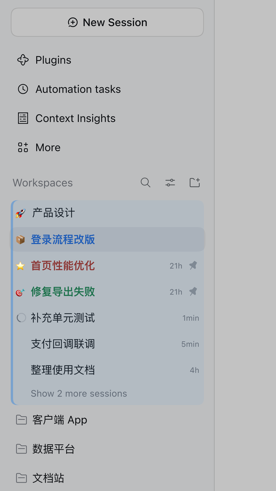
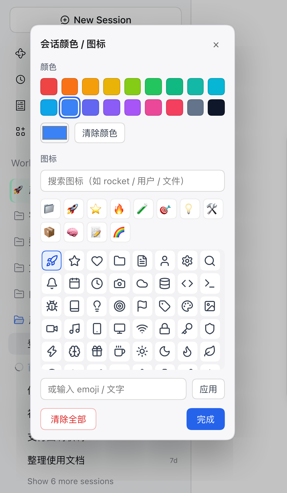

# dsh-session-row-tint

给 DeepSeek Harness（DSH）Web 侧栏加上「可自定义」的会话与工作区装饰：

- **工作区**：整块（标题行 + 下面整个会话列表）铺一层淡色底，文件夹图标可换成 emoji / 文字。
- **会话**：标题文字用该会话自己的颜色（不铺背景，避免和工作区底色叠在一起发浑），左侧状态点可换成 emoji / 文字。
- **入口在行自己的「...」菜单**里：点「颜色 / 图标」打开小面板（不抢右键，避免和其它右键插件冲突），数据持久化在 profile 数据目录，重启不丢。

> 可选依赖 [`@idoall/dsh-session-colors`](https://github.com/idoall/dsh-session-colors)：如果装了它，它的会话颜色标记（`GET /plugins/dsh-session-colors/marks`）会被读作会话标题文字色；不装也能用，颜色 / 图标全部由本插件自己的面板与存储提供。

## 截图

工作区整块淡色底 + 工区 emoji + 会话标题上色 + 会话 emoji：



「颜色 / 图标」面板（预设色 + 可搜索图标）：



## 功能

- **工作区行**「...」→「颜色 / 图标」：设置该工作区背景色（整块）与文件夹图标。
- **会话行**「...」→「颜色 / 图标」：设置该会话标题文字颜色与左侧图标。
- 面板支持：18 个预设颜色一键选用、系统取色器、可搜索的 [Lucide](https://lucide.dev)（MIT）开源图标（按英文名或中文关键词搜索，内置两百多个）、12 个常用 emoji、清除颜色 / 清除全部。
- 颜色/图标按 id 存到一个 JSON 文件（原子写入），跨重启保留。

## 安装

本插件是一个标准 **profile bundle**（`package.json` 声明了 `dsh.bundle.patch`），因此会出现在 DSH 的「插件」列表里，可以像其它 bundle 一样开关。

1. 在目标 profile 的 `package.json` 里加依赖并登记 bundle（`<profile>` 换成你的 profile，如 `desktop`）：

   ```json
   {
     "dependencies": {
       "dsh-session-row-tint": "github:lingyired/dsh-session-row-tint"
     },
     "dsh": {
       "profile": {
         "bundles": [
           "dsh-session-row-tint"
         ]
       }
     }
   }
   ```

2. 在 profile 的 `cordis.patch.yml` 末尾给 bundle 插入的条目配 `dataDir`（换成你的 profile 数据目录）：

   ```yaml
   - id: dsh-session-row-tint
     name: dsh-session-row-tint
     config:
       dataDir: /absolute/path/to/profiles/<profile>/data/dsh-session-row-tint
   ```

3. 在该 profile 目录执行 `pnpm install`。

4. **重启 DeepSeek Harness**（宿主半边只在启动时装载），刷新页面。

> 不配 `dataDir` 也能用，但颜色/图标只活在宿主进程内存里，重启即丢。

## 存储

- 数据文件：`<dataDir>/decorations.json`

  ```json
  {
    "version": 1,
    "workspaces": { "<workspaceId>": { "color": "#4a90d9", "icon": "🚀" } },
    "sessions": { "<sessionId>": { "color": "#c0392b", "icon": "⭐" } }
  }
  ```

- HTTP 路由（浏览器半边使用，复用 DSH 的鉴权栅栏）：
  - `GET  /plugins/dsh-session-row-tint/decorations` → `{ workspaces, sessions, storage }`
  - `POST /plugins/dsh-session-row-tint/workspaces` → `{ workspaceId, color?, icon? }`
  - `POST /plugins/dsh-session-row-tint/sessions`  → `{ sessionId, color?, icon? }`

## 实现要点

- 纯浏览器渲染，完全不改 DSH 自带文件：
  - 注册进 `shell.overlay` 槽位，画在一块**点击穿透**的浮层上；面板是独立 portal。
  - 通过 `[data-row-key="workspace:<id>"]` / `[data-row-key="session:<id>"]`、`role="treeitem"` 定位行。
  - 会话图标画在左侧 `span.JoiKIa_slot` 位置并隐藏原状态图形；工区图标画在文件夹图标位置。
- 为避免与源插件重复绘制，会隐藏源插件的细色条 `.dsh-sc-chip`。

## 兼容性

在 **DSH `0.2.1-rc.5`** 上实测可用。用到的都是公开槽位（`shell.overlay`）与行 DOM 属性（`data-row-key`、`role=treeitem`、`aria-selected`）；DSH 大改侧栏结构时最坏情况是装饰不显示，不会影响点击。

## 已知限制

- 给会话设了自定义图标后，会盖住左侧的运行状态点/转圈。
- 会话标题使用自定义颜色时，请自行确保在浅/深色主题下对比度可读。

## 目录

```
cordis.patch.yml  bundle 挂载：往 loader 插入宿主条目
src/index.js      宿主半边：workspaces/sessions 装饰存储 + HTTP 路由
src/client.js     浏览器半边：shell.overlay 浮层、右键面板、渲染
docs/images/      演示截图（脱敏示例数据）
```

## License

MIT
